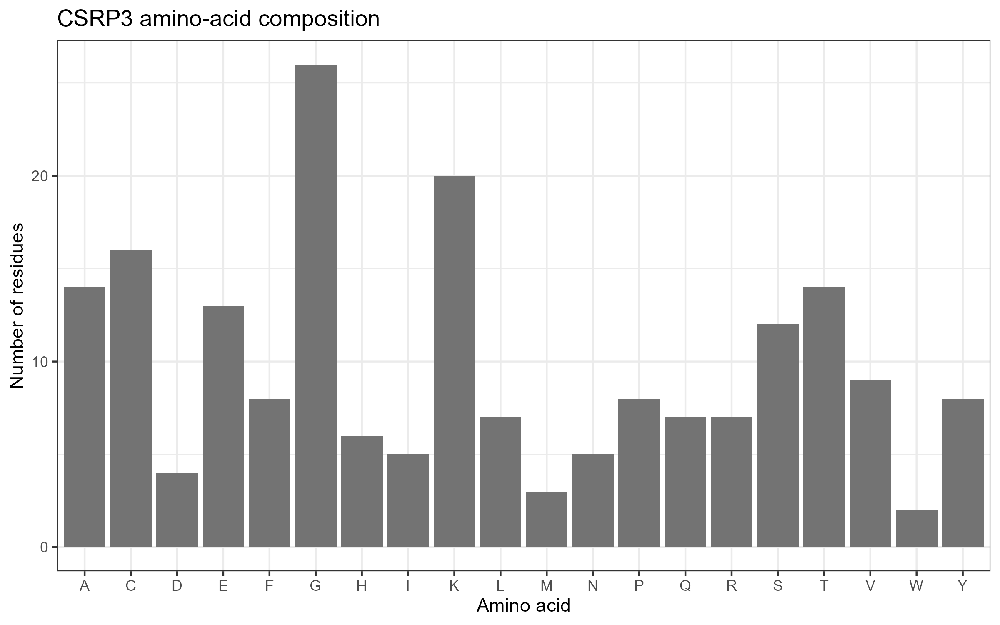

# Molecular Mechanisms of Muscle Contractility: CSRP3 Gene Analysis

## Gene and Database Identifiers

| Information | Retrieved Record |
|:---|:---|
| **Assignment Number** | 20 |
| **Assigned Gene** | CSRP3 |
| **NCBI Gene ID** | 8048 |
| **Assigned Transcript Accession** | NM_003476.5 |
| **Matching Protein Accession** | NP_003467.1 |
| **Protein Length** | 193 amino acids |
| **ClinVar Variation ID** | 8777 |
| **Assigned Variant** | NM_003476.5:c.172T>G (p.Cys58Gly) |
| **Variant Classification** | Pathogenic |
| **ClinVar Review Status** | Criteria provided, multiple submitters, no conflicts (2 stars) |

---

## I. Project Overview

This project investigates the human **CSRP3 (Cysteine and Glycine Rich Protein 3)** gene and its associated missense variant using R-based sequence retrieval, protein analysis, and variant interpretation.

The analysis focuses on the reference protein encoded by the assigned transcript and examines the potential molecular consequences of the pathogenic variant p.Cys58Gly.

## II. Research Question

What is the amino-acid composition of the human CSRP3 reference protein, and how may the assigned p.Cys58Gly variant affect Muscle LIM Protein function and contribute to cardiomyopathy?

## III. Objectives

1. Retrieve the human CSRP3 gene record from NCBI.
2. Identify the protein accession corresponding to the assigned transcript NM_003476.5.
3. Retrieve and analyze the reference protein sequence using R.
4. Determine the protein length and amino-acid composition.
5. Visualize the amino-acid composition and the position of the assigned variant.
6. Examine the ClinVar classification and available evidence associated with p.Cys58Gly.
7. Explain the possible molecular mechanism connecting the variant to muscle dysfunction.
8. Propose an experiment to investigate the proposed mechanism.

## IV. Methods

### 4.1 Software and Packages

The analysis was performed using **R version 4.3.2** in RStudio.

The following R packages were used:

- `rentrez` – retrieval of nucleotide, gene, and protein records from NCBI Entrez.
- `ggplot2` – generation of amino-acid composition and variant-position figures.

### 4.2 Project Setup

An RStudio project named `Muscle_Contractility_CSRP3` was created. The project was organized into separate folders for sequence data, analysis results, and figures.

```r
dir.create("data", showWarnings = FALSE)
dir.create("results", showWarnings = FALSE)
dir.create("figures", showWarnings = FALSE)
```

The assignment information was defined in R:

```r
gene_symbol <- "CSRP3"
transcript_accession <- "NM_003476.5"
clinvar_id <- "8777"
variant_protein <- "p.Cys58Gly"
```

### 4.3 Retrieval of the Human CSRP3 Gene Record

The `rentrez` package was used to search the NCBI Gene database for the human CSRP3 gene. The search was restricted to the human organism using its taxonomy identifier (9606).

```r
library(rentrez)
library(ggplot2)

hits <- entrez_search(
  db = "gene",
  term = "CSRP3[Gene Name] AND txid9606[Organism]",
  retmax = 20
)

gene_id <- hits$ids[1]

gene_info <- entrez_summary(
  db = "gene",
  id = gene_id
)

print(gene_info)
```

The retrieved record was verified to correspond to CSRP3, with NCBI Gene ID 8048. The gene information was saved as `results/gene_summary.txt`.

### 4.4 Retrieval of the Matching Protein Sequence

The assigned transcript, NM_003476.5, was retrieved from the NCBI Nucleotide database in GenBank format. Its corresponding RefSeq protein accession was identified from the transcript record.

```r
gb <- entrez_fetch(
  db = "nuccore",
  id = transcript_accession,
  rettype = "gb",
  retmode = "text"
)

pat <- '/protein_id="NP_[0-9]+[.][0-9]+"'

fragment <- regmatches(
  gb,
  regexpr(pat, gb)
)

protein_accession <- gsub(
  '^/protein_id="|"$',
  "",
  fragment
)
```

The matching protein sequence was retrieved from the NCBI Protein database in FASTA format.

```r
protein_fasta <- entrez_fetch(
  db = "protein",
  id = protein_accession,
  rettype = "fasta",
  retmode = "text"
)

writeLines(
  protein_fasta,
  "data/CSRP3_protein.fasta"
)
```

The retrieved protein accession was NP_003467.1. It was also recorded in `results/protein_accession.txt`.

### 4.5 Protein Length and Amino-Acid Composition

The retrieved FASTA sequence was read into R. The header was excluded, and the remaining sequence was converted into individual amino-acid residues.

```r
fasta_lines <- readLines(
  "data/CSRP3_protein.fasta"
)

sequence <- paste(
  fasta_lines[!grepl("^>", fasta_lines)],
  collapse = ""
)

aa <- strsplit(
  toupper(sequence),
  ""
)[[1]]

protein_length <- length(aa)
```

The frequencies of the 20 standard amino acids were calculated.

```r
standard <- strsplit(
  "ACDEFGHIKLMNPQRSTVWY",
  ""
)[[1]]

counts <- table(
  factor(aa, levels = standard)
)

aa_results <- data.frame(
  AminoAcid = standard,
  Count = as.integer(counts)
)

write.csv(
  aa_results,
  "results/amino_acid_composition.csv",
  row.names = FALSE
)
```

The resulting table was used to generate an amino-acid composition bar plot.

```r
fig1 <- ggplot(
  aa_results,
  aes(AminoAcid, Count)
) +
  geom_col(fill = "grey45") +
  theme_bw() +
  labs(
    title = "CSRP3 amino-acid composition",
    x = "Amino acid",
    y = "Number of residues"
  )

print(fig1)

ggsave(
  "figures/01_amino_acid_composition.png",
  fig1,
  width = 8,
  height = 5,
  dpi = 300
)
```

### 4.6 ClinVar Variant Identification and Documentation

The assigned variant was examined using the NCBI ClinVar database.

The following information was documented:

- Gene: CSRP3
- Transcript: NM_003476.5
- Nucleotide change: c.172T>G
- Protein change: p.Cys58Gly
- ClinVar Variation ID: 8777
- Variant type: Single nucleotide missense variant
- Aggregate germline classification: Pathogenic
- Review status: Criteria provided, multiple submitters, no conflicts (two stars)

The associated clinical conditions, submitter information, and cited publications were also examined.

ClinVar record: https://www.ncbi.nlm.nih.gov/clinvar/variation/8777/

### 4.7 Variant-Position Visualization

The amino-acid position was extracted from the protein variant notation p.Cys58Gly. The position was compared with the total reference protein length and plotted on a linear protein schematic.

```r
matched <- regmatches(
  variant_protein,
  regexpr("[0-9]+", variant_protein)
)

position <- as.integer(matched)

fig2 <- ggplot() +
  geom_segment(
    aes(
      x = 1,
      xend = protein_length,
      y = 0,
      yend = 0
    ),
    linewidth = 2
  ) +
  geom_point(
    aes(x = position, y = 0),
    size = 4
  ) +
  annotate(
    "text",
    x = position,
    y = 0.25,
    label = variant_protein,
    size = 4
  ) +
  xlim(0, protein_length) +
  ylim(-0.6, 0.6) +
  theme_void() +
  labs(
    title = paste(gene_symbol, "reference protein"),
    x = "Amino-acid position"
  ) +
  theme(
    axis.title.x = element_text()
  )

print(fig2)

ggsave(
  "figures/02_variant_position.png",
  fig2,
  width = 8,
  height = 2.5,
  dpi = 300
)
```

The resulting plot identifies the position of the Cys58Gly substitution within the 193-amino-acid reference protein.

## V. Results

### 5.1 Gene and Protein Retrieval

The human CSRP3 gene was successfully retrieved from NCBI Gene.

| Parameter | Result |
|:---|:---|
| Gene symbol | CSRP3 |
| NCBI Gene ID | 8048 |
| Official name | Cysteine and glycine rich protein 3 |
| Chromosome | 11 |
| Transcript | NM_003476.5 |
| Protein accession | NP_003467.1 |
| Protein length | 193 amino acids |

### 5.2 Amino-Acid Composition

The retrieved CSRP3 reference protein contained 193 amino-acid residues.

The three most abundant amino acids were:

| Amino Acid | Count |
|:---|---:|
| Glycine (G) | 26 |
| Lysine (K) | 20 |
| Cysteine (C) | 16 |

**Figure 1. Amino-acid composition of the CSRP3 reference protein.**



The bar plot presents the frequency of each of the 20 standard amino acids in the reference protein.

### 5.3 Variant Position

The assigned variant, p.Cys58Gly, occurs at amino-acid position 58 of the 193-amino-acid CSRP3 reference protein.

**Figure 2. Position of the p.Cys58Gly variant in the CSRP3 reference protein.**


The figure illustrates the sequence location of the substitution. It does not independently demonstrate changes in protein structure or function.

### 5.4 ClinVar Variant Information

| Parameter | Result |
|:---|:---|
| Variant | NM_003476.5:c.172T>G |
| Protein change | p.Cys58Gly |
| Variation ID | 8777 |
| Type | Missense |
| Classification | Pathogenic |
| Review status | Two stars |
| Associated conditions | Hypertrophic cardiomyopathy 12; dilated cardiomyopathy 1M; cardiovascular phenotype |

ClinVar reports that multiple submitters contributed to the aggregate pathogenic classification. The record indicates criteria provided by multiple submitters without conflicting classifications.

## VI. Molecular Mechanism

### 6.1 Normal Protein Function

The **CSRP3** gene encodes Muscle LIM Protein (MLP), a protein predominantly expressed in cardiac and skeletal muscle. Unlike proteins that directly participate in the actin–myosin cross-bridge cycle, MLP is a non-sarcomeric protein involved in cellular signaling and the maintenance of muscle integrity. It contributes to the organization of muscle cells and participates in signaling processes that allow cardiomyocytes to respond to mechanical stress. Therefore, CSRP3 primarily supports muscle structure and cellular signaling rather than directly regulating muscle contraction or calcium transport.

### 6.2 Molecular Effects of the Assigned Variant

The assigned variant is **NM_003476.5:c.172T>G (p.Cys58Gly)**, recorded in ClinVar under Variation ID **8777**. This missense substitution replaces cysteine with glycine at amino acid position 58 of the MLP protein.

Experimental evidence from Ehsan et al. (2018) demonstrated that the C58G mutation causes reduced MLP protein abundance. The researchers observed increased degradation of the mutant protein through the ubiquitin–proteasome system. The study also reported an interaction between mutant MLP and BAG3, accompanied by a proteotoxic response. Experimental animals carrying the mutation exhibited cardiac dysfunction.

ClinVar classifies this variant as Pathogenic, with a two-star review status indicating criteria provided by multiple submitters without conflicting classifications. Clinical observations and experimental findings support its association with cardiomyopathy. Computational predictions provide additional supporting evidence but should be distinguished from direct experimental observations.

### 6.3 Proposed Molecular Mechanism

The proposed molecular mechanism can be summarized as follows:

**CSRP3 gene → Muscle LIM Protein (MLP) → muscle structural maintenance and cellular signaling → p.Cys58Gly substitution → increased protein degradation through the ubiquitin–proteasome system → reduced functional MLP abundance → impaired cardiac signaling and remodeling → possible development of cardiomyopathy.**

The experimental findings support protein depletion as an important mechanism associated with the C58G mutation. However, the precise contribution of each downstream signaling change to disease development requires further investigation.

### 6.4 Proposed Validation Experiment

A **Western blot analysis of MLP protein abundance** is proposed to investigate whether the C58G substitution promotes protein degradation. Cultured cardiac cells expressing either normal CSRP3 or mutant CSRP3 (C58G) would be prepared. Cellular proteins would be extracted and analyzed through Western blotting to compare MLP abundance between the two groups.

An additional group of mutant-expressing cells would receive a proteasome inhibitor to determine whether blocking proteasomal degradation restores MLP levels.

The expected result is lower MLP abundance in cells expressing the mutant protein compared with cells expressing normal MLP. If proteasome inhibition increases mutant MLP abundance, this would further support the involvement of proteasomal degradation in the molecular mechanism.

## VII. Questions and Answers

### 1. What does your assigned gene encode, and how does this protein contribute to muscle function?

The CSRP3 gene encodes Muscle LIM Protein (MLP), a protein predominantly expressed in cardiac and skeletal muscle. MLP is a non-sarcomeric protein involved in muscle structural maintenance and intracellular signaling. It contributes to the organization of muscle cells and participates in responses to mechanical stress. Unlike myosin or calcium-regulating proteins, MLP does not directly drive the actin–myosin cross-bridge cycle or transport calcium. Instead, it supports muscle integrity and cellular signaling.

### 2. What was the exact protein accession and length retrieved with R?

The protein sequence retrieved from the assigned transcript NM_003476.5 corresponded to RefSeq protein accession **NP_003467.1**, identified as Muscle LIM Protein isoform 1. The retrieved reference protein contained **193 amino-acid residues**.

### 3. What did the amino-acid composition chart show? What can it NOT tell you?

The amino-acid composition analysis showed that glycine was the most abundant residue, with 26 occurrences, followed by lysine with 20 and cysteine with 16. The reference protein contained 193 amino acids in total.

However, amino-acid frequency alone cannot establish protein folding, three-dimensional structure, functional activity, protein interactions, or the pathogenic effect of a specific mutation. It describes the relative abundance of amino-acid residues rather than directly measuring protein function.

### 4. What is your fixed ClinVar variant, and what is its current classification and evidence strength?

The assigned variant is **NM_003476.5:c.172T>G (p.Cys58Gly)**, registered in ClinVar as Variation ID **8777**. It is a missense variant in which cysteine is replaced by glycine at amino-acid position 58 of MLP.

ClinVar classifies the variant as Pathogenic, with a two-star review status indicating criteria provided by multiple submitters without conflicting classifications. Supporting evidence includes observations in individuals with hypertrophic cardiomyopathy, segregation with disease in affected families, computational predictions of a damaging effect, and experimental studies demonstrating altered CSRP3 function.

### 5. What is the scientifically supported mechanism linking this variant to muscle function, and what remains uncertain?

Experimental findings indicate that the C58G substitution promotes MLP protein depletion through increased ubiquitin–proteasome-mediated degradation. Ehsan et al. (2018) demonstrated reduced MLP abundance in heterozygous and homozygous knock-in mice, accompanied by cardiac dysfunction in homozygous animals. The study also reported an interaction between mutant MLP and BAG3 and evidence of a proteotoxic response.

These findings support a mechanism in which reduced functional MLP abundance contributes to abnormal cardiac signaling and remodeling. However, the precise sequence of molecular events leading from protein depletion to cardiomyopathy, as well as variation in disease severity among individuals carrying the variant, requires further investigation.

### 6. What additional experiment would help test the proposed mechanism?

Western blot analysis could be performed using cultured cardiac cells expressing either normal CSRP3 or the C58G mutant. MLP protein abundance would be compared between the two groups. An additional mutant-expressing group could be treated with a proteasome inhibitor to determine whether inhibition of protein degradation restores MLP abundance.

The expected result is reduced MLP abundance in mutant-expressing cells, with a possible increase following proteasome inhibition. This experiment would help test whether the C58G substitution promotes MLP depletion through proteasomal degradation.

## VIII. Discussion

The present analysis examined the human CSRP3 gene and its associated missense variant, c.172T>G (p.Cys58Gly), using NCBI resources and R-based sequence analysis. The assigned transcript, NM_003476.5, was used to retrieve the corresponding RefSeq protein, NP_003467.1, which contained 193 amino-acid residues. Amino-acid composition analysis identified glycine as the most abundant residue (26), followed by lysine (20) and cysteine (16). These results describe the protein's amino-acid composition but cannot independently establish its structural conformation, biological activity, or the functional consequences of a mutation.

The assigned C58G variant is classified as Pathogenic in ClinVar (Variation ID 8777). Clinical evidence includes reports of the variant in individuals with hypertrophic cardiomyopathy and its segregation with disease in affected families. Computational prediction also suggests a potentially damaging effect. However, these findings should be distinguished from direct experimental evidence.

Ehsan et al. (2018) investigated the C58G mutation using a knock-in mouse model and cellular experiments. Their findings demonstrated reduced MLP protein abundance, with approximately 50% reduction in heterozygous mice and 80% reduction in homozygous mice. The researchers associated this depletion with increased proteasomal degradation and reported an interaction between mutant MLP and BAG3. Homozygous knock-in mice also exhibited systolic and diastolic cardiac dysfunction. These observations support protein depletion as an important mechanism linking the C58G variant to cardiomyopathy.

Nevertheless, the experimental findings do not fully explain all molecular events involved in disease development or the differences in clinical presentation among affected individuals. The proposed mechanism should therefore be interpreted within the limitations of the experimental models. A Western blot experiment comparing normal and mutant MLP expression, with and without proteasome inhibition, could further validate the proposed mechanism.

Overall, this analysis demonstrates how sequence retrieval, amino-acid composition analysis, variant interpretation, and published experimental evidence can be integrated to investigate a disease-associated muscle protein variant.

## IX. Limitations

1. The amino-acid composition analysis describes residue frequencies but does not directly determine protein structure, folding, stability, or biological activity.
2. The variant-position plot identifies the location of the substitution but does not demonstrate its structural or functional consequences.
3. ClinVar classifications are based on submitted clinical and scientific evidence and may be updated as additional evidence becomes available.
4. The proposed Western blot experiment was not performed as part of this computational analysis.
5. Findings from experimental mouse models cannot automatically be generalized to every individual carrying the variant.
6. The analysis focused on one assigned transcript, one reference protein, and one specific variant.

## X. Proposed Validation Experiment

A Western blot experiment is proposed to evaluate whether the C58G substitution promotes MLP degradation.

Cultured cardiac cells would be divided into groups expressing either normal CSRP3 or mutant CSRP3 (C58G). An additional mutant-expressing group would receive a proteasome inhibitor. Cellular proteins would then be extracted and analyzed using Western blotting, with an appropriate loading control to compare MLP abundance.

The expected outcome is lower MLP abundance in cells expressing mutant C58G compared with cells expressing normal MLP. If proteasome inhibition increases mutant MLP abundance, this would support the involvement of proteasomal degradation in the molecular mechanism.

## XI. Reproducibility Instructions

The analysis can be reproduced using a fresh R installation with internet access.

### Requirements

- R version 4.3.2 or a compatible newer version
- RStudio
- Internet connection for NCBI Entrez retrieval

### Required R Packages

```r
install.packages("rentrez")
install.packages("ggplot2")
```

### Running the Analysis

1. Download or clone the public GitHub repository.
2. Open the RStudio project or set the working directory to the downloaded project folder.
3. Open `analysis.R`.
4. Install and load the required packages.
5. Run the entire script using the **Source** button in RStudio.
6. Check the `data`, `results`, and `figures` folders for the generated outputs.

The script retrieves the CSRP3 transcript and its corresponding protein accession from NCBI, downloads the FASTA sequence, calculates protein length and amino-acid composition, and generates the two figures.

### Errors and Corrections

During the workflow, the nucleotide transcript accession and protein accession were distinguished to ensure that the correct sequence was analyzed. The assigned NM_003476.5 transcript was used to identify its matching NP_003467.1 protein accession. An unrelated protein record from an earlier activity was not used in the final CSRP3 analysis.

The final analysis used the matching human CSRP3 reference protein sequence and verified that its length was 193 amino acids.

## XI. Repository Structure

```text
Muscle-Contractility-CSRP3/
│
├── README.md
├── analysis.R
│
├── data/
│   └── CSRP3_protein.fasta
│
├── results/
│   ├── gene_summary.txt
│   ├── protein_accession.txt
│   └── amino_acid_composition.csv
│
└── figures/
    ├── 01_amino_acid_composition.png
    └── 02_variant_position.png
```

## XII. References and Database Links

### Scientific References

1. Ehsan, M., et al. (2018). Mutant Muscle LIM Protein C58G causes cardiomyopathy through protein depletion. *Journal of Molecular and Cellular Cardiology, 121*, 287–296. https://doi.org/10.1016/j.yjmcc.2018.07.248

2. Geier, C., et al. (2003). Mutations in the human muscle LIM protein gene in families with hypertrophic cardiomyopathy. *Circulation, 107*(10), 1390–1395. https://pubmed.ncbi.nlm.nih.gov/12642359/

### NCBI Database Records

| Database | Record | Link |
|:---|:---|:---|
| NCBI Gene | CSRP3, Gene ID 8048 | [NCBI Gene](https://www.ncbi.nlm.nih.gov/gene/8048) |
| NCBI Nucleotide | NM_003476.5 | [NCBI Nucleotide](https://www.ncbi.nlm.nih.gov/nuccore/NM_003476.5) |
| NCBI Protein | NP_003467.1 | [NCBI Protein](https://www.ncbi.nlm.nih.gov/protein/NP_003467.1) |
| NCBI ClinVar | Variation ID 8777 | [NCBI ClinVar](https://www.ncbi.nlm.nih.gov/clinvar/variation/8777/) |

**Database access date:** November 4, 2026.
